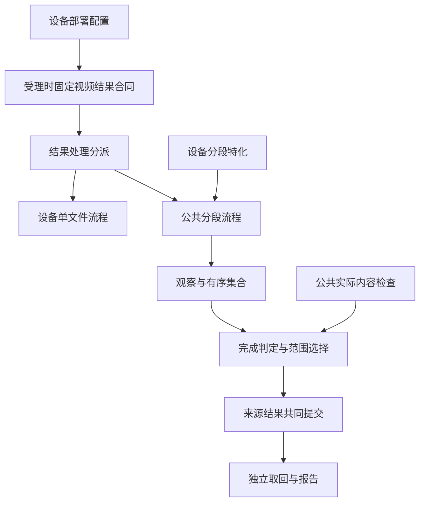

# 视频结果模式与公共分段处理设计

## 目标与文档分工

每台相机通过部署配置选择单文件或多段视频处理。单文件处理和多段处理分别具有完整的执行、失败、取消及恢复流程；多段能力由公共处理层承接，再由设备特化提供文件和判定规则。

本规格适用于普通录像及原生延时生成的视频。照片继续遵守[单张拍摄与延时摄影](../../architecture/camera-capture.md)的独立产物规则。设备控制、停止、有限任务等待及取消资格仍由原动作契约负责；视频结果模式决定如何解释和处理这些控制操作产生的文件。

| 权威规格 | 定义的内容 |
| --- | --- |
| 本规格 | 部署选择、两种处理流程的边界、公共分段模型、实际内容检查、默认范围、检查副本复用、共同提交及报告。 |
| [Action6 视频结果特化](2026-10-23-action6-video-segmentation-design.md) | DJI 命名、MP4 主视频度量、延时采样目标、照片类别及设备完成规则。 |
| [OSMO 360 II 分段特化](2026-10-20-osmo360ii-record-segmentation-design.md) | CAM 命名、OSV 分段下界与选段数、空尾分类、双路主视频及设备验收。 |

公共层不根据设备名称、文件后缀或已出现的文件数量临时选择处理流程。设备特化不重复实现结果分页、可靠拷贝、来源发布、取回或历史重建。

## 部署配置与受理

配置项为 `devices.<id>.video.result_mode`，按每台相机统一设置，同时作用于该设备的普通录像和原生延时视频。

| 值 | 含义 |
| --- | --- |
| `single_file` | 默认值。选择该设备原有的单文件视频处理流程。 |
| `segmented` | 选择公共分段流程，并由驱动绑定该设备的分段特化。 |

例如：

```toml
[devices.action6.video]
result_mode = "single_file"

[devices.osmo.video]
result_mode = "segmented"
```

这是设备部署选择，不是拍摄参数或客户端计划字段。相机声明与其他部署字段继续按[配置参考](../../camctl/configuration-reference.md)组织。`video` 必须为表，只接受 `result_mode`；省略该表或该字段采用默认值。错误类型、非法值及未知子字段按配置错误处理；设备不支持所选模式时，在部署能力绑定阶段按驱动规则错误处理。校验失败不发送拍摄命令，也不改用另一模式。

驱动根据模式提供本次任务的产物要求及结果处理合同。能力说明应反映当前部署模式及对应产物要求；相同拍摄参数在不同模式下仍表示相同采集目标。

首次受理将选定模式、适用的分段特化和目标解释规则保存到动作执行定义。后续修改配置只影响之后受理的任务；执行、重启和历史恢复使用本动作已保存的选择，不重新读取配置决定流程。单文件模式也使用显式选择，不以缺少策略字段表达。

开发阶段可统一重构模式、结果策略、存储及历史结构，不要求读取或迁移重构前的格式。当前执行定义仍遵守[首次受理后固定](../../camctl/database/execution-definitions.md)的业务规则；这项要求与旧格式兼容无关。

## 两种处理流程

| 范围 | 单文件模式 | 多段模式 |
| --- | --- | --- |
| 普通录像 | 保留设备原有的一份必要视频、正常完成及单原片异常媒体处理。 | 一个动作管理有序视频集合，按策略确定完成依据及默认范围。 |
| 原生延时 | 保留设备原有有限任务、产物检查和文件保留规则；数量继续由该任务的产物规则决定。 | 原有限任务负责控制完成，公共层处理有序视频集合；独立照片继续按原规则处理。 |
| 异常内容处理 | 保留单原片检查、适用的多录修复及派生成品规则。 | 根据分段策略选择整段原片，实际内容策略按必要分段逐份检查。 |
| 正式产物与交付 | 继续原有原片、预览及适用修复成品身份。 | 每段原片和预览分别登记，默认范围与全部保留原片分别表达。 |

单文件普通录像遇到多份必要视频时，按本模式的原数量合同处理，不自动切换为多段。原生延时继续原来的最低格式与数量合同，不因模式名称新增精确文件数要求。

两种模式共用设备操作、文件传输、媒体工具、持久化内核和交付基础能力，但结果处理各自闭合。各入口均按冻结模式分派，包括正常完成、启动失败、异常恢复、外部失败、取消和提交未知后的接续。

## 公共层与设备特化



| 责任 | 提供或消费的合同 |
| --- | --- |
| 模式解析与任务绑定 | 读取部署选择，检查支持范围，形成显式的任务结果合同。 |
| 设备分段特化 | 提供视频类别、名称解析、排序键与后继关系、预览配对、空文件分类、目标解释、完成依据和默认范围策略。 |
| 公共分段编排 | 保存原始观察与完整边界，按冻结特化调用判定，推进必要检查，统一处理有限进度和来源发布。 |
| 公共实际内容检查 | 接收目标量纲及主视频度量规则，完整拷贝必要分段，累计可靠指标并选择最短连续前缀。 |
| 文件、取回和历史基础 | 执行可靠拷贝、独立交付、检查副本使用、清理及同边界恢复，不重新解释设备规则。 |

公共实际内容检查可供不同设备使用。Action6 特化通过提供 MP4 主视频规则和任务目标使用它；OSMO 特化提供自己的完成下界、保守选段及空尾规则。设备特化可以组合公共能力，不要求所有设备都执行媒体检查或采用相同的完成算法。

公共模块依赖明确的策略合同和结果类型；设备实现依赖公共类型及端口。持久化和取回消费已经形成的策略结果，不反向调用某个相机完成模块。具体模块、类名和物理表由实施计划按这一依赖方向组织。

## 观察、有序集合与产物

启动前可靠保存的完整目录基准、本次活动及结果页共同确定文件归属，遵守[本次任务文件归属](../../architecture/camera-capture.md#本次任务的文件归属)。名称与索引用于已归属文件的顺序，不替代基准或设备占用。

原片、预览、照片及零字节文件均先保存实际观察。文件已写完、归属可靠、顺序可靠、扫描到末页及集合完整分别表达；文件出现或长度稳定不单独证明其中任一条件。

先前可靠取得的合格文件继续保留，后轮失败或遗漏不抹去这些事实。当前完整性只由当前可靠页链与文件事实证明，不能把跨轮保留文件合并成一次假定完整的扫描。

视频序列与独立照片分别解释。每份符合保留条件的原片均登记，包括默认视频范围之外的原片；预览按实际配对拥有独立身份。照片不会因没有视频排序键而使视频顺序未知，也不被视频范围筛掉。

### 起点、连续性与缺口

视频起点采用本次已可靠观察并保存的最早视频位置，原片、预览和空文件观察均参与判定。文件后来缺失或被判不合格时，不把起点后移。没有可靠位置时保持未知，不用基准最大编号、返回顺序、datetime 或固定索引补造起点。

沿设备特化声明的后继关系形成连续序列。缺失位置只保存排序键或区间、前后真实文件及依据，不创造路径、datetime 或 `output_id`。空文件按特化分类，分类未知与明确不合格分别保留。

连续前缀不越过缺口、冲突顺序、不合格原片或所需指标未知的位置。已经留下可靠观察的首段缺失可以检测；在首次可靠观察前消失且没有任何原片、预览或历史记录的位置不在首段检测保障内。

## 正常流程与策略判定

正常任务继续自己的控制、有限目标等待及全部必需产物规则。默认视频范围为本次全部合格视频，不为缩短正常范围增加主机拷贝或媒体检查。仅在终态登记前中断，且正常完成事实已经可靠保存的任务，继续原正常登记。

异常时先完成适用的停止、文件写完、归属和有限核实。设备特化声明本次使用的完成和范围策略；实际内容策略进入后文的逐段检查，其他策略按其自身可靠依据形成范围。

正常流程的资格来自设备特化要求的可靠控制来源，不从最终停止状态、文件完成或控制时长与目标的大小关系反推。Action6 普通录像按[正常与异常分区](2026-10-23-action6-video-segmentation-design.md#正常异常与动作结果)消费原正常 STOP 结果；正常调度迟到不额外触发检查。单原片裁剪余量不参与多段策略选择。

检查责任已经建立时，恢复先沿原检查及其输入 READ 继续，已保存的目标、预算、结果与覆盖决定保持。后来取得控制成功依据，只参与适用处理结束后的动作判定，不把已开始的检查改成未执行，也不通过重新选择全部视频来绕过原连续前缀。原 READ 结束申请、检查结果或来源发布的提交尚未核实时，先沿各自原申请和操作键完成核实。

取消、已有终态和持久化错误优先按所属规则处理。普通录像取消放弃内容；原生延时取消将默认视频范围固定为全部已确认归属且写完的合格视频，并保留独立照片，动作保持取消，不继续追求原采集目标。已开始的文件操作和工具进程须实际收场后才能清理副本。已有来源终态继续原结果。时钟异常会话只保存允许的有限收场进度，不启动或恢复媒体拷贝与检查。

## 公共实际内容检查

### 目标和度量

目标提供者从任务已保存的参数和采样合同产生精确目标；主视频度量提供者从完整本地副本产生同量纲的可靠实际值。

| 量纲 | 目标及累计方式 |
| --- | --- |
| 主视频时长 | 目标为精确时长，各段主视频时长累加，统一单位后比较，不先舍入。 |
| 主视频帧数 | 目标为整数帧数，各段可靠主视频帧数直接累加，不从播放时长估计帧数。 |

明确采用采样位置 `0, I, 2I, ... <= D` 的任务，目标帧数为 `floor(D/I)+1`；非整数倍时不虚构终点采样。采用其他采样合同的设备由自己的目标提供者解释。播放帧率用于换算预期播放时长，不从本次实测结果反推目标，也不改变整数帧数比较。

容器、音频、封面或预览的时长不充当主视频时长。主视频无法识别、必要轨道不全或指标不可靠时保留未知。多路主视频的必要性及汇总规则由特化明确，不把不同视角的时长相加。实测值、策略下界和控制计时分别保存。

### 逐段执行

1. 保存检查责任、冻结集合、目标量纲和原有限预算。
2. 从可靠起点取得下一份连续视频的精确文件身份与完成事实。
3. 按[可靠拷贝](../../architecture/file-copy.md)将该段完整拷到主机，核对完整长度、摘要和落盘结果。部分或完整性未确认的副本不交给媒体工具。
4. 对本地完整副本取得可靠主视频时长或帧数，保存实际工具结果及已发现的问题。必要时对本地文件计数，不以 `时长 × 帧率` 冒充实际帧数。
5. 把本段可靠指标加入连续累计量，首次达到目标时结束覆盖选段；未达到时继续下一段。
6. 有限处理结束后保存最终覆盖和范围，与来源结果共同提交。

每个被检查分段具有独立、可恢复的检查身份、输入副本和工具结果。共享可靠拷贝及受管工具能力，不把多段检查表示成同一个单原片录像处理记录被反复更换来源。工具退出、文件存在、字节校验和媒体内容问题分别记录。

超时、重试、断点、取消和实际子进程收场沿原责任保存；重启不重置预算。空间不足按现有规则快速失败，不等待释放后无限重试。

### 覆盖与范围决策

| 事实 | 覆盖结论 | 默认视频范围 |
| --- | --- | --- |
| 正常流程未执行检查 | 未执行 | 全部合格视频。 |
| 连续可靠累计量首次达到目标 | 已达到 | 达到目标的最短连续前缀。 |
| 可靠完整集合无未解释缺口，全部内容已检查且累计不足 | 已确认不足 | 已检查的完整连续集合。 |
| 未达到目标，下一段拷贝或度量有限处理后仍未知 | 未确认 | 中断位置之前已检查的连续前缀。 |
| 未达到目标，前方有明确缺口或不合格原片 | 未确认，并保留明确失败事实 | 中断位置之前已检查的连续前缀。 |
| 起点或顺序不足以确认任何前缀 | 未确认 | 范围未确认。 |

已检查前缀可为空。已知空范围、未确认范围和来源没有任何正式产物分别表达。仅部分前缀低于目标，不能证明本次全部内容不足；未知指标也不填成零。

最后选中的分段完整交付。所有符合保留条件的范围外原片继续登记，显式 ID 可取回。范围一经提交，后续补查、清理或取回均不扩大它，也不用后段替换已选文件。

## 动作结果与默认取回

设备特化提供符合自身控制和内容合同的成功依据；公共编排分别保存动作终态、覆盖评价、默认范围与正式产物。明确设备失败、必要原片缺失、可靠缺口、已确认内容不足及明确媒体错误，不能被后续控制成功覆盖。

实际内容策略在其他必要条件满足且没有明确失败时，达到目标可提供内容成功依据。覆盖未确认但已有可靠控制完成依据时，动作可以成功；既无控制成功依据也无内容成功依据时失败。必要检查和有限处理仍未结束时，不提前提交成功。

停止失败不证明设备空闲。动作终态与[设备执行情况](../../architecture/report-format.md#动作结束后设备是否仍在执行)分别表达，媒体量也不补造历史开始或停止时间。

| 取回方式 | 选择行为 |
| --- | --- |
| 普通默认取回 | 固定视频范围内的原片，加上按原规则选择的独立照片。 |
| 手动或自动视频预览 | 对同一视频范围逐份选择实际配对预览，照片继续其独立原片规则。 |
| 明确 `output_ids` | 精确选择真实产物，可包含范围外视频及照片。 |
| 视频范围已知为空 | 视频选择形成来源级失败，不创建视频 delivery；照片及其他来源继续处理。 |
| 视频范围未确认且来源已终态 | 默认视频选择形成来源级失败，不重新扫描或改选全部视频；照片及其他来源继续处理。 |

来源失败本身不禁止取回，已发布非空前缀可按实际文件成功交付。默认或预览选择中，来源已失败、适用处理结束且完整正式产物目录为空时，优先使用来源级 `source_action_failed`；不以分段范围未确认掩盖这一事实。已有产物和显式 ID 的处理保持原规则，完整分类见[来源失败错误设计](2026-10-24-source-action-failed-design.md)。每个取回仍创建独立 delivery 和交付文件；同一请求重送继续原身份。清理遵守原请求范围，不以默认范围代替全部保留产物。

## 检查副本与等待取回的复用

本节用于已经产生检查副本的分段策略。副本成立依据是原分段检查的完整、可靠校验和对应原片；设备正式源保持，生命周期与固定等待者采用[来源临时副本的有限复用](../../architecture/file-copy.md#来源临时副本的有限复用)。来源结果提交事务固定截点 H，后到请求不加入原集合，取回及源回退保持原独立责任。

本策略只使用准确对应所选原片的检查副本。预览取回仍使用实际预览文件，不能用视频检查副本冒充；分段检查校验及本地文件核验继续按本策略原契约执行。原检查、结果提交、绑定取回及实际文件操作未收场时保留副本，具备清理资格后沿原责任删除。

来源提交前仍有效的部分检查副本可以沿原身份续传；来源已提交且原检查责任已经结束的部分副本，在实际操作收场后清理，不继续已经结束的检查。来源提交未知先核实原完整事务，不用重启后的等待者集合替换原截点。

## 持久化、共同提交与恢复

| 唯一归属 | 保存的事实 |
| --- | --- |
| 原拍摄动作 | 模式与特化选择、集合引用、判断目标、完成依据、覆盖评价、固定视频范围及缺口。 |
| 独立文件和检查责任 | 精确来源身份、完成及完整性、逐段副本、原拷贝进度、主视频指标和实际工具结果。 |
| 来源后处理的复用关系 | 来源提交截点、副本与原片的准确关系、已绑定取回及使用责任。 |
| 各取回动作 | 自己的选择、delivery、交付文件、读取与发布及逐项结果。 |

检查事实保存实际采用目标、各段度量、已评估分段、可靠连续累计量、首个中断位置及原因。依据与结论能够相互核对，不能只保存检查完成标记。

来源终态事务共同提交全部应保留产物、默认视频范围到真实产物的关联、适用覆盖、动作结果、等待转换及副本复用关系。取回不能看见半套结果。保存未知先核实原申请，不重新编号、重算范围或重复登记。

成员、逐段检查、缺口、范围和等待者按[公共存储规则](../../camctl/database/common.md#普通列子表与-json-的分工)分页处理；小型执行定义及错误头不包含增长集合。[分批形成事务事件](../../camctl/database/transactions.md#分配事件编号与核对引用)仍保持来源共同可见性。

恢复优先处理已有终态、取消和原申请，其余沿保存进度继续。已确认的 START、STOP、文件等待、检查和范围不重复执行或改判；历史回放不访问设备、运行媒体工具或清理文件。

新记录登记[历史归属与快照成员](../../camctl/database/history-formats.md#自身记录与快照成员)，报告从[同一历史边界](../../camctl/historical-state-query.md#分批读取与分段生成报告)恢复来源、范围、覆盖、文件及取回。后续摘要、清理、补查或新取回不进入旧边界；改变批次和恢复方向不改变同一报告字节。

## 报告与客户端

### 整体覆盖结果

采用实际内容策略的普通录像及原生延时，在形成可靠结果决定后通过 `result.coverage` 报告下列事实。参数尚未生效或尚未形成覆盖决定时不补造结果。字段和枚举的准确机器表示只在根 `protocol` 维护；单文件任务及其他分段策略按自己的结果合同报告。

| 信息 | 含义 |
| --- | --- |
| 目标及量纲 | 本任务采用的精确目标时长或整数帧数。 |
| 覆盖结论 | 未执行、已达到、已确认不足、未确认分别表达。 |
| 已确认内容量 | 已检查连续前缀的实际主视频时长或帧数，未知与零分别表达。 |
| 前缀及默认范围 | 关联实际分段和正式产物，区分非空、空及未确认范围，照片不充当视频成员。 |
| 原因 | 实际检查中断、缺口、指标未知或明确错误，并能定位真实观察。 |

覆盖结果独立于单文件 `media`、动作 `status/error` 及各次取回。成功动作也可报告覆盖未确认；累计值不写进某个文件的时长。策略分段下界不是实测时长，不写成已执行媒体检查或实际内容达标。

公共协议、报告字段依赖、安装资源、客户端校验及展示共同同步。报告逐文件保留原片、照片、预览和 delivery 的身份、大小与 SHA-256；范围外原片仍可明确选择。设备拍摄顺序与公共报告实体排序分别遵守各自合同。

客户端按实际交付文件名核验每份文件，部分媒体未到、媒体先到或报告先到均按逐项事实处理。[累计 ACK](../../architecture/status-reports.md#ack)按报告完整应用与覆盖取得资格，媒体到达不单独推进确认。

## 验收与重构边界

| 维度 | 必须验证的结果 |
| --- | --- |
| 模式配置 | 两台相机各自支持显式单文件和多段；默认单文件，两类视频任务共用设备选择，非法配置不执行拍摄。 |
| 单文件独立流程 | 两台相机普通单原片成功、数量错误、异常检查和适用修复保持；原生延时保留原有限任务及产物要求。 |
| 分段公共能力 | 分页归属、观察起点、跨目录顺序、缺口、逐段产物和配对，照片不被视频范围过滤。 |
| 实际内容策略 | 不等长分段、精确阈值、帧数目标、未知前缀及确认不足；达到目标后不继续为选段复制后段。 |
| 设备特化 | Action6 的 MP4 与采样目标、OSMO 的下界与空尾各自取得独立结果，不互相套用。 |
| 副本与取回 | 来源提交截点、多个等待者、后到请求、独立交付、源读取保护、全部相关取回终态后的清理及部分副本收场。 |
| 取消与恢复 | 两类动作取消差异、时钟受限会话、原提交未知、有限预算、范围冻结和同边界报告。 |

软件和安装版联合链覆盖两台设备、两种模式及两类视频动作，并复用相应设备的既有控制测试。开发重构可以调整公共模型、模块、枚举和数据库结构；各模式的目标行为及设备特化必须由直接回归证明。

软件、ARM 部署、真实控制、媒体内容、客户端接收及 ACK 各自保留证据。固件与目录契约由设备特化说明，真实设备和物理故障按独立安排验证，软件替身不提供设备媒体结论。
